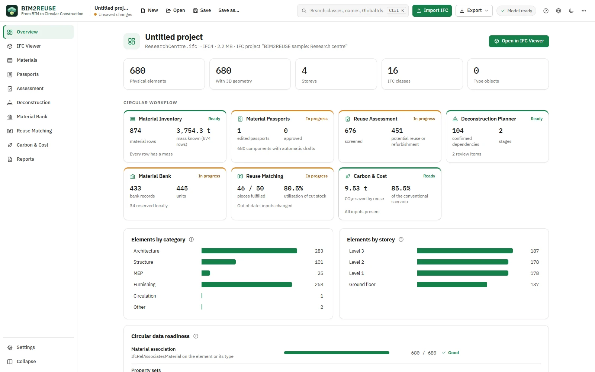
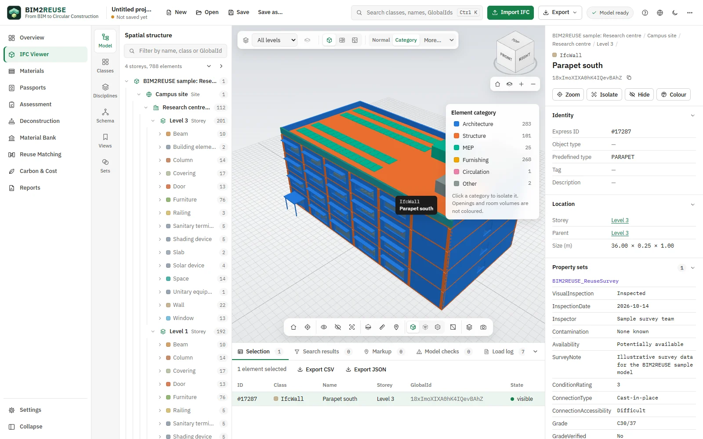
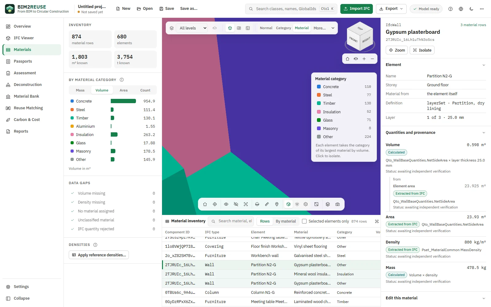
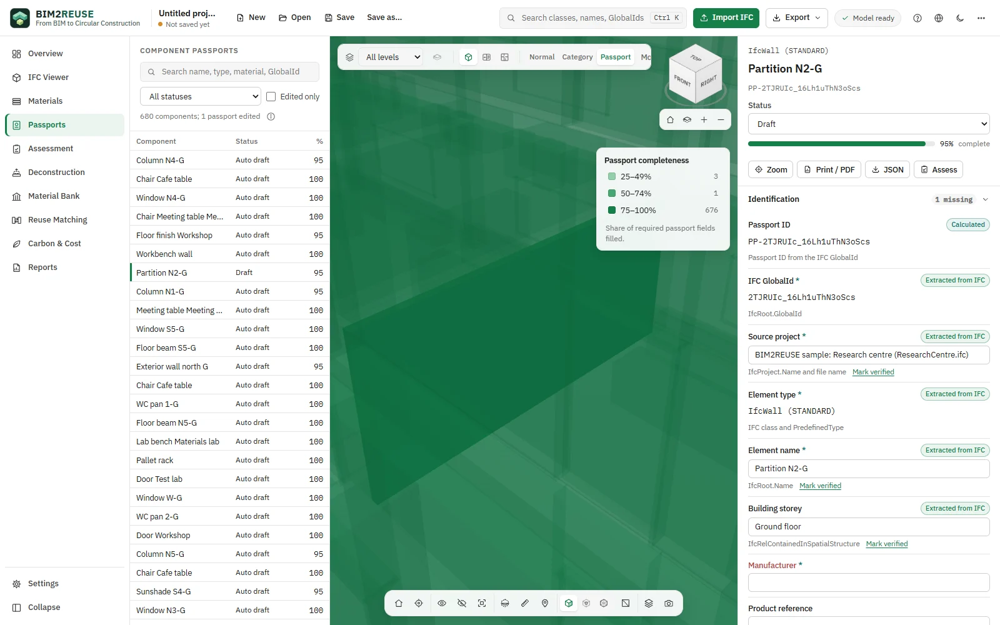
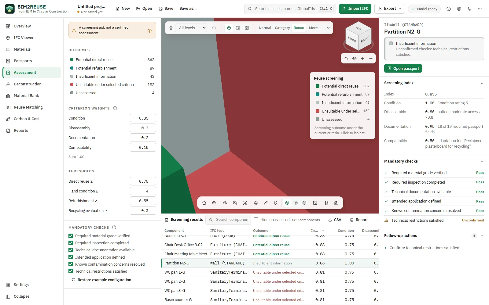
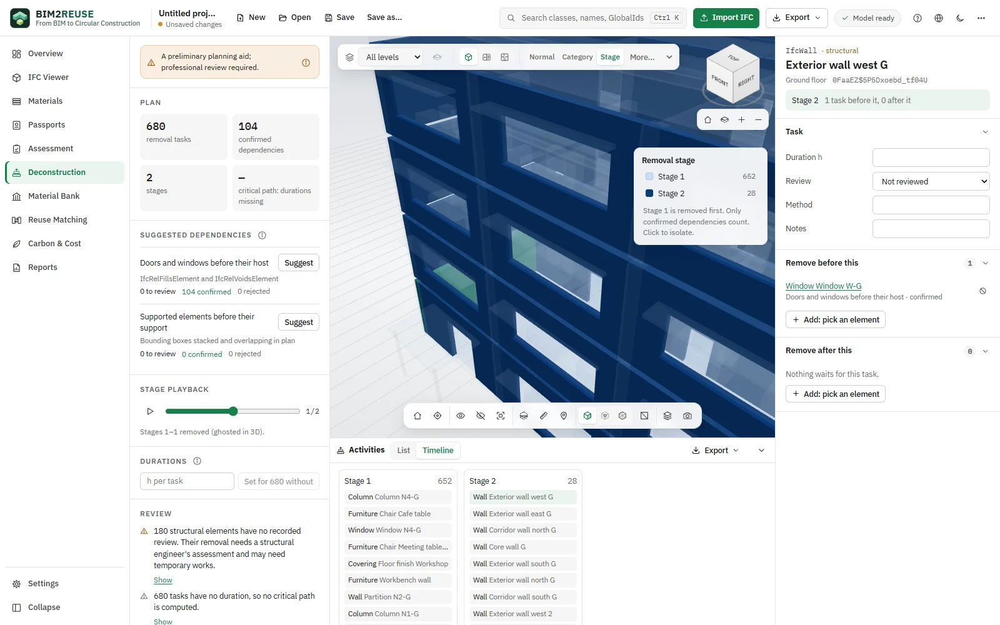
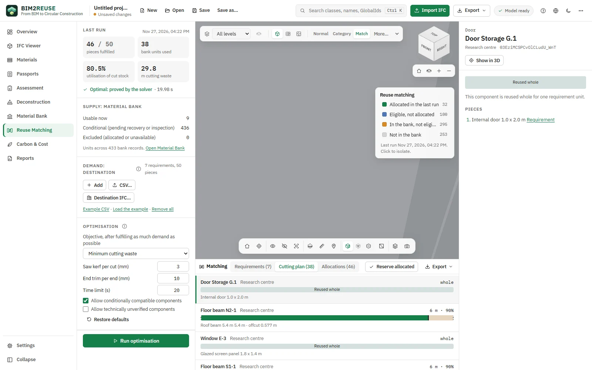
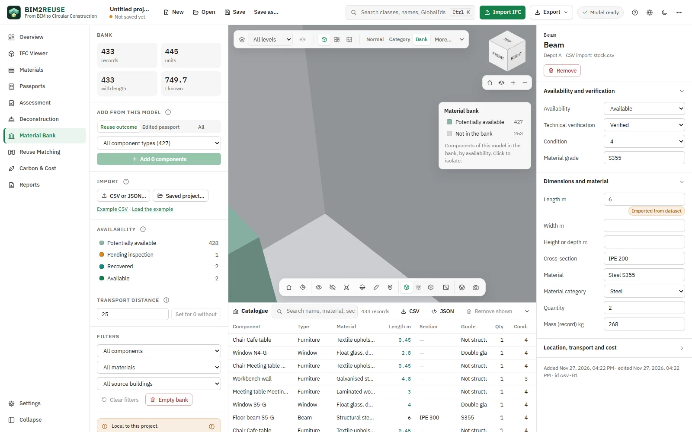
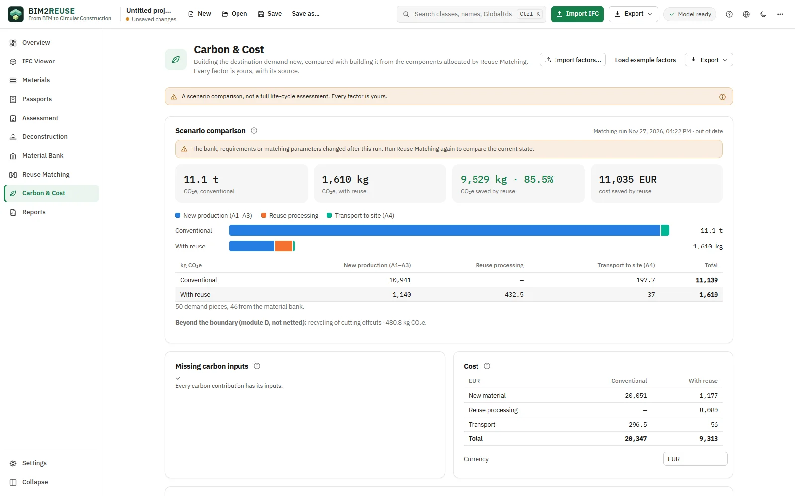
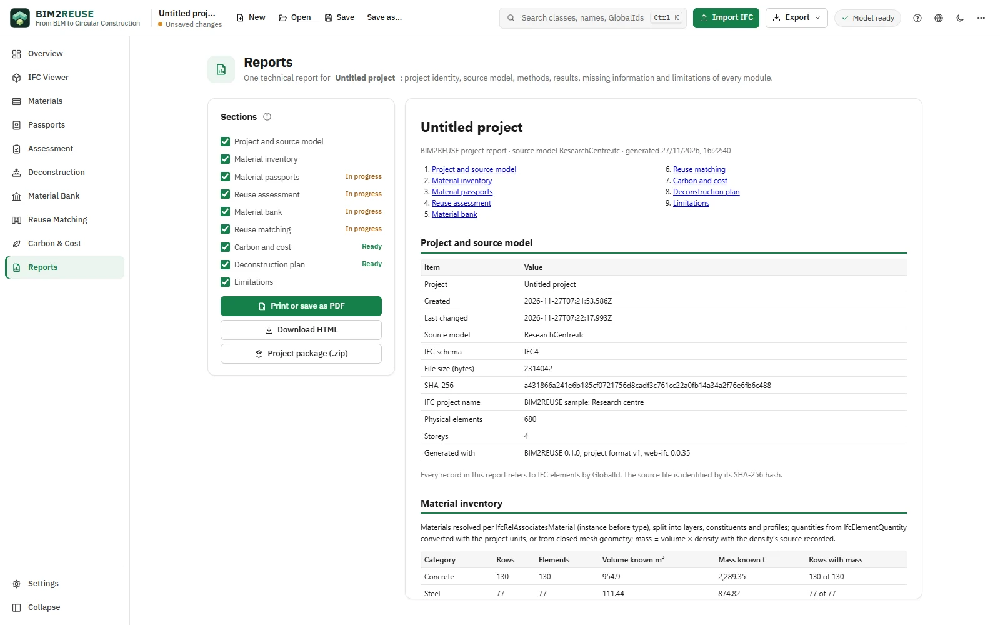

<div align="center">

<a href="https://isaddiq.github.io/BIM2Reuse/">
  <picture>
    <source media="(prefers-color-scheme: dark)" srcset="assets/logos/bim2reuse-wordmark-dark.svg" />
    
  </picture>
</a>

**Turn IFC building models into traceable material reuse decisions, in the browser.**

[](https://isaddiq.github.io/BIM2Reuse/)

[](LICENSE)
[](https://technical.buildingsmart.org/standards/ifc/)
[](#privacy)

[Workflow](#workflow) · [Modules](#modules) · [Try the sample](#try-the-sample) · [Your own data](#your-own-data) · [Principles](#principles-and-limitations) · [Citation](#citation)

<br />

<picture>
  <source media="(prefers-color-scheme: dark)" srcset="assets/images/readme/overview-dark.webp" />
  
</picture>

</div>

**BIM2REUSE** is a free, open-source web application for circular construction. Open the IFC model of an existing building, and BIM2REUSE builds the information that reuse decisions need:

- what the building is made of;
- which components could be reused;
- how they come out;
- where they could go in a new building;
- what that saves in carbon and cost.

Every record stays linked to the IFC GlobalId of the element it describes.

<a id="privacy"></a>🔒 **Private by design.** There is no server. IFC files are read on your device with web-ifc (WebAssembly), and projects are saved in your browser. Nothing you open or enter is uploaded.

## Workflow

| Step | Module | Result |
| --- | --- | --- |
| 1. Explore | **IFC Viewer** | The model in 3D and on floor plans, with every element's data |
| 2. Inventory | **Materials** | Materials, volumes and masses of every element, with the source of each value |
| 3. Document | **Passports** | A material passport for each component |
| 4. Assess | **Assessment** | A screening of each component's reuse pathway |
| 5. Plan | **Deconstruction** | Removal stages from a dependency graph of tasks |
| 6. Bank | **Material Bank** | A catalogue of recoverable components from one or more buildings |
| 7. Match | **Reuse Matching** | An optimal allocation of banked components to a new building, with cutting plans |
| 8. Compare | **Carbon & Cost** | The new building's demand built new, compared with it built from reused components |
| 9. Report | **Reports** | One technical report, printable to PDF |

The **Overview** shows the model at a glance, how ready its data is for each module, and the status of every module for the open project.

## Modules

### IFC Viewer



- **Views:** 3D, floor plans, or both side by side.
- **Browse:** model tree, IFC classes and disciplines, an IFC schema browser, saved views and selection sets.
- **Inspect** each element: property sets, quantities, materials, type, classification and relationships.
- **Tools:** search, hide, isolate, X-ray, section box, plan cut, measuring and issue pins.
- **Colour modes** show each module's data on the model (material, passport, reuse outcome, removal stage, bank availability, matching result), with legends that isolate on click.

### Material inventory



- **Materials** are read per element and per type, with layered walls, composite windows and profiled beams split into their materials.
- **Quantities** come from the IFC file and are checked against the geometry.
- **Mass** = volume × density. The density is taken from the file, entered by you, or from a reference dataset you choose to apply.
- **Data-gap filters** show exactly which values are missing.
- **Export** as CSV or JSON, with the source of every value.

### Passports and reuse assessment



- **Passports** cover identification, geometry, materials, condition, connections, reuse, sustainability and evidence (files you attach).
- **Pre-filled from the model:** fields are filled from the IFC data, including survey data the model carries. You complete or correct the rest.
- **Approval** for a specific use requires recorded evidence, a completed inspection and verification.
- **The assessment** combines mandatory checks with a weighted screening index. A failed check always wins over a high score.
- **Outcomes:** potential direct reuse, refurbishment, recycling evaluation, inspection required, insufficient information, or unsuitable.



### Deconstruction planner



- **Tasks:** one removal task per element.
- **Suggested dependencies:** doors and windows before their host wall, and supported elements before their support. A suggestion counts only after you confirm it, and you can add your own.
- **Analysis:** removal stages, dependency cycles, and the critical path once durations are entered.
- **Review warnings,** for example for structural elements nobody has reviewed yet.
- **Outputs:** stage playback in 3D, a timeline, and CSV, JSON and Graphviz exports.

### Material bank and reuse matching



- **The bank** collects components from the open model, from CSV or JSON inventories, and from other saved projects. Each record has an availability state and editable data. Reservations stay local to the project.
- **Requirements** of the new building are typed in, imported from CSV, or read from a destination IFC model.
- **Matching** checks every component against every requirement: type, material, grade, section, length, size, condition, availability and verification. Missing data is never treated as compatible.
- **The optimiser** (HiGHS, a mixed-integer solver running in the background) fulfils as much demand as possible. It then minimises cutting waste, cost or transport, allowing for saw kerf and end trimming. The solver status is reported as returned.
- **Results:**
  - fulfilled and unmet demand, with a reason for each unmet requirement;
  - cutting diagrams;
  - allocations, and reservation of the components used;
  - a report.



### Carbon and cost



- **Two scenarios:**
  - **Conventional:** the new building's demand produced new (A1–A3) and transported to site (A4).
  - **With reuse:** matched components reprocessed and transported from their source, with only the unmet pieces produced new.
- **Your factors:** every carbon and cost factor is entered or imported by you, with its source. Missing inputs are listed, and no saving is stated until both scenarios are complete.
- **Module D:** recycling of cutting offcuts is reported separately, outside the totals.

### Reports



The report gives the project identity and the source model with its file hash. For each module it states the method, results, missing information and limitations. Print it to PDF from the browser or save it as HTML.

The **project package** (`.bim2reuse.zip`) holds every record, the source IFC file and attached evidence, so a project can be reopened on another computer.

## Try the sample

Choose **Try a sample model** on the start page. The sample is the *Research centre*, a four-storey building generated for BIM2REUSE (IFC4, MIT licence). It contains every kind of data the modules use:

- material layer, constituent and profile sets, with densities;
- base quantities for every element;
- 40 steel IPE 300 floor beams, doors and windows in their wall openings, a precast stair core, furniture, glazing and PV panels;
- a project classification and manufacturer data;
- an **illustrative reuse survey** on each component: condition, inspection, connections, grade and application.

Example files for the other modules come with it. Load each one with **Load the example** (or **Load example factors**) in its module, or download it as a template:

| File | Used in | Contents |
| --- | --- | --- |
| [research-centre-bank.csv](assets/samples/research-centre-bank.csv) | Material Bank | Stock recovered from a second building: glulam and steel beams, doors |
| [research-centre-requirements.csv](assets/samples/research-centre-requirements.csv) | Reuse Matching | Requirements of a new pavilion: steel beams of three lengths, a glulam ridge beam, doors, glazed panels and steel columns |
| [research-centre-carbon-factors.csv](assets/samples/research-centre-carbon-factors.csv) | Carbon & Cost | Illustrative carbon and cost factors for steel, timber, glass and transport |

**Suggested path:**

1. Open the sample and look at **Materials**, **Passports** and **Assessment**.
2. In **Deconstruction**, suggest the door and window dependencies and confirm them.
3. In **Material Bank**, add the components with a reuse outcome, load the example stock, and set a transport distance.
4. In **Reuse Matching**, load the example requirements and run the optimisation.
5. In **Carbon & Cost**, load the example factors.
6. Open **Reports**.

> The survey data and the example factors are invented to demonstrate the workflow. They are labelled as such in the files and are not product or EPD data.

## Your own data

**IFC models.** Any IFC2x3, IFC4 or IFC4.3 file opens. The more of the following a model carries, the more BIM2REUSE fills in for you:

| Data in the model | Used for |
| --- | --- |
| `IfcRelAssociatesMaterial`, including layer, constituent and profile sets | Inventory, passports, matching |
| `IfcElementQuantity` (base quantities) | Volumes, areas and lengths |
| `MassDensity` on materials (`Pset_MaterialCommon`) | Mass |
| `IfcRelFillsElement` and `IfcRelVoidsElement` | Deconstruction dependencies |
| `IfcRelAssociatesClassification` | Data readiness, reports |
| `Pset_ManufacturerTypeInformation` | Passport identification |
| Survey properties named `ConditionRating`, `VisualInspection`, `InspectionDate`, `ConnectionType`, `Contamination`, `Grade`, `GradeVerified`, `CandidateApplication`, `ApplicationFit`, `VerificationStatus`, `TechnicalDocumentation` (in any property set) | Passports and assessment |

**CSV files.** The bank, requirement and factor imports accept comma- or semicolon-separated files with a header row. Lengths are in metres and masses in kilograms. Rows that fail validation are listed with the reason; nothing is guessed. The example files above show every column.

## Principles and limitations

- **No invented data.** Missing values stay missing. Each value records where it came from: IFC, geometry, an imported file, a manual entry or a verified inspection.
- **Suggestions are not decisions.** Dependencies, densities and compatibility rest on data a person confirms or supplies.
- **Honest optimisation.** The solver status is reported as returned, and every solution is checked against the rules before it is shown.
- **Stated limits:**
  - The reuse index is a screening aid, not a certified structural or regulatory assessment.
  - The carbon comparison is not a full life-cycle assessment to EN 15978.
  - The deconstruction plan is preliminary. Structural removal, temporary works and site safety need qualified professional review.
  - Compatibility uses only the criteria supplied; structural reuse needs professional verification.

The method draws on IFC (ISO 16739), EN 15804, ISO 14040/14044, ISO 22057 and ISO 59020. BIM2REUSE does not claim compliance with these standards.

## Run your own copy

BIM2REUSE is a static site. Serve the repository folder over HTTP; `file://` URLs block WebAssembly and workers.

```bash
git clone https://github.com/isaddiq/BIM2Reuse.git
cd BIM2Reuse
npx serve .
```

Built with React 18, Three.js, web-ifc 0.0.35 and HiGHS 1.16 (vendored in `assets/vendor/highs/`). Browser storage uses IndexedDB.

## Citation

If you use BIM2REUSE in research, please cite it:

```bibtex
@software{bim2reuse,
  author = {Saddiq},
  title  = {{BIM2REUSE}: From BIM to Circular Construction},
  year   = {2026},
  url    = {https://github.com/isaddiq/BIM2Reuse}
}
```

The workflow builds on the D5 digital circular workflow: [Five digital steps towards matchmaking for material reuse in construction (npj Materials Sustainability, 2024)](https://www.nature.com/articles/s44296-024-00034-8).

## Licence

The code and the Research centre sample are released under the [MIT licence](LICENSE).

- **HiGHS** (`assets/vendor/highs/`) is MIT licensed.
- **Icons** in `assets/icons/flaticon/` are credited in their `ATTRIBUTION.md`.

Made by **Saddiq** · [isaddiq.github.io](https://isaddiq.github.io/)
